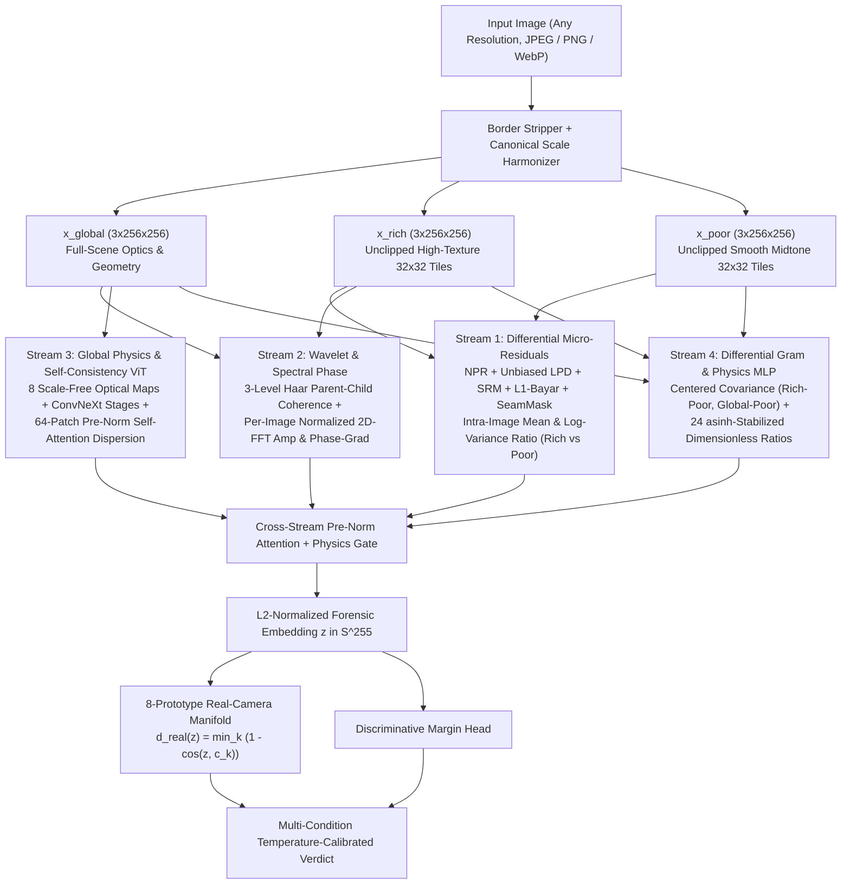

# ArtifactNet v4: From-Scratch 4-Stream Differential & Real-Manifold AI Image Detector

[-EE4C2C?style=for-the-badge&logo=pytorch&logoColor=white)](https://pytorch.org/)
[](https://developer.nvidia.com/cuda-toolkit)
[](https://www.nvidia.com/)
[](https://pytorch.org/docs/stable/amp.html)
[](https://gradio.app/)
[](#architecture-artifactnet-v4)
[](LICENSE)

---

## Executive Summary

**ArtifactNet v4** is a digital image forensics system designed and trained **strictly from scratch** (zero pretrained weights, zero external datasets) on a single 79,950-image paired dataset (`data/train.csv`) to distinguish AI-generated images from authentic camera photographs.

When training from scratch on a single dataset whose synthetic half comes from a single generator family, naive binary classifiers fall into **two severe traps**:
1. **Single-Generator Shortcut ("Default = 99.9% Real")**: Binary cross-entropy (`Real=0` vs `Generator_A=1`) memorizes the training generator's narrow high-frequency spike. Unseen generators (Midjourney v6, FLUX.1, DALL-E 3, SDXL) lack that exact spike and collapse to `99.9% Real`.
2. **Container & Scale Lock-In (`768px JPEG Q75 4:2:0`)**: All 79,950 training images are `<=768px` JPEG Q75 (`4:2:0`). High-resolution camera photos (`3000px–4000px`, phone ISP sharpening) or lossless `PNG` / `JPEG Q96 (4:4:4)` uploads shift raw `1:1` micro-tile statistics off the training manifold.

ArtifactNet v4 solves these challenges without external data or pretrained backbones through five core innovations:
1. **8-Prototype Real-Camera Manifold on $\mathbb{S}^{255}$**: Models diverse authentic camera photography modes inside a compact multi-prototype hypersphere so unseen generators are flagged as **out-of-camera-manifold anomalies** rather than defaulting to Real.
2. **Intra-Image `Rich - Poor` Differential Forensics**: Compares textured patches (`x_rich`) against unclipped smooth midtone patches (`x_poor`) *from the same image*, cancelling global ISO level and file codec (`PNG` vs `JPEG Q95` vs `JPEG Q65`).
3. **Pair-Synchronized Augmentation Pipeline**: Applies identical sub-`8×8` DCT grid shifts, multi-interpolation scaling (`0.56×–1.38×`), smartphone ISP blur/sharpening/shot-noise, and `4:4:4` / `4:2:0` recompression to both halves of each matched `(Real_k, AI_k)` pair—mathematically cancelling scene, scale, ISP, and compression shortcuts.
4. **GPU `SpectralRingDropout`**: Randomly notches out radial and angular 2D-FFT bands identically across paired samples during training so the model cannot rely on any single generator frequency peak.
5. **Multi-Condition Post-Training Calibration & 4-View Multi-Scale TTA**: Fits temperature, manifold blend, and L2-regularized 24-descriptor statistical physics weights across clean and domain-shifted views (`1.8×` upscale, `0.68×` lossless PNG, `Q96 4:4:4`, smartphone ISP).

---

## Engineering Post-Mortem: Evolution from v1 & v2 to v4

| Issue Identified in v1 / v2 | Measured Impact in Audit | ArtifactNet v4 Resolution |
|---|---|---|
| Binary hyperplane (`Real` vs `DeepMedia`) | Unseen `1792×1024` / `1216×832` AI images defaulted to `Real` (`mean p = 0.258`), while Real-Manifold distance already separated them `2.8×–5.2×` | Active-from-Epoch-1 **8-Prototype Real-Camera Manifold** + matched-pair distance margin ranking |
| `synthesize_decoder_artifact` flipped Real photos to `AI (1.0)` after bicubic resize or bilateral+sharpen | Taught the model that normal smartphone ISP processing = AI; `2×` upscale dropped Real Specificity to **8.0%** | Removed label-flipping pseudo-fakes; ISP & scale transforms applied **symmetrically** to paired `(Real_k, AI_k)` |
| Hand-crafted `ForensicCouncil` 12-rule quorum (`>= 6 flags`) | **6 of 12 formulas had `AUC < 0.50`** on validation (`Bayer CFA` `AUC=0.189`, `Chromatic Aberration` `AUC=0.249`), dropping validation accuracy from **99.0% to 72.0%** | Replaced guessed thresholds with **data-calibrated** 24-ratio `ScaleFreePhysicsExtractor` (`asinh` + L2 Logistic Calibration) & monochrome gating |
| Missing `x_global` in `evaluate.py` & `BatchNorm1d` drift | `model(x_rich, x_poor)` fed scrambled tiles into 6 global branches; `BatchNorm1d` drifted on high-res PNGs | Unified `prepare_forensic_views()` contract + **100% `GroupNorm` / `LayerNorm`** architecture (zero `BatchNorm`) |

---

## Architecture: ArtifactNet v4

Defined in [`src/model.py`](src/model.py) and [`src/forensics.py`](src/forensics.py) (**100% From Scratch, Zero `BatchNorm`**):



---

## Quickstart & CLI Workflows

### 1. Environment Check
```bash
.venv\Scripts\activate
python src/check_setup.py
```

### 2. Train ArtifactNet v4 From Scratch (~2.2 Hours on RTX 5060 Ti 16GB, ~7.8 GB VRAM)
```bash
# Full 18-epoch training (effective batch 64 = 32 x 2 grad-accum) + legacy backup + multi-condition calibration
python src/train.py
```
 Useful flags:
- `--resume`: Seamlessly resume an interrupted run from `checkpoints/last_model_v4.pth` (restores model, EMA, optimizer, cosine LR step, and history).
- `--calibrate-only`: Re-run multi-condition temperature, manifold, and statistical physics calibration on `checkpoints/best_model_v4.pth` (~30 seconds).

### 3. Run the 7-Part Hold-Out & Out-of-Domain Stress Evaluation
Evaluates the untouched 7,996-image `test_split`, runs 5 cross-domain & shortcut-knockout stress benchmarks (`1.8×` Upscale, `0.68×` Lossless PNG, `JPEG Q96 4:4:4`, Smartphone ISP, and `FFT High-Freq Knock-Out`), generates `assets/test_evaluation_v4.png`, and produces 4-View Multi-Scale TTA predictions in `submission_v4.csv` / `submission.csv`:
```bash
python src/evaluate.py
```

### 4. Launch Interactive Gradio XAI Inspector
```bash
python app.py
```
Open `http://127.0.0.1:7860` to inspect any camera photo or synthetic image with 4-View Multi-Scale TTA, Real-Camera Manifold distance (`d_real` vs `τ`), calibrated per-stream scores, and dual spatial XAI heatmaps.

### 5. Export Weights to SafeTensors / Hugging Face
```bash
python prepare_hf_export.py
```

---

## Repository Structure

```text
ai-vs-real-detector/
├── assets/
│   ├── training_curves_v4.png       # Clean vs Perturbed OOD F1 & Specificity curves
│   └── test_evaluation_v4.png       # Hold-out Confusion Matrix, ROC, and 6-Condition Stress Chart
├── checkpoints/
│   ├── archive_v2/                  # Automatic backup of legacy v1/v2 checkpoints
│   ├── best_model_v4.pth            # Best Generalization Score EMA + Multi-Condition Calibrated weights
│   ├── best_model.pth               # Mirror of best_model_v4.pth
│   ├── last_model_v4.pth            # Latest epoch state for --resume
│   └── training_history_v4.csv      # Per-epoch Clean, Perturbed, Stream, and Manifold metrics
├── data/
│   ├── splits/                      # Zero-leakage pair-aware splits (train/val/test)
│   ├── train.csv                    # 79,950 paired metadata rows
│   └── test.csv                     # 5,540 unlabeled test_data_v2 metadata rows
├── src/
│   ├── check_setup.py               # Hardware, CUDA BFloat16, parameter count & dataset check
│   ├── dataset.py                   # Canonical preprocessor, PairedForensicDataset & OOD perturbations
│   ├── evaluate.py                  # 7-benchmark hold-out, stress-test & TTA submission pipeline
│   ├── forensics.py                 # NPR, Unbiased LPD, SRM, L1-Bayar, SpectralRingDropout & 24 Physics Ratios
│   ├── forensic_council.py          # 4-View Multi-Scale TTA Inspector & Spatial XAI Heatmap generator
│   ├── model.py                     # ArtifactNetV4 (4 Streams + 8-Prototype Real-Camera Manifold)
│   ├── train.py                     # Pair-synchronized BFloat16 trainer & post-training calibrator
│   └── utils.py                     # ArtifactNetV4Loss, ModelEMA & multi-condition calibration
├── app.py                           # Interactive Gradio 4 XAI Web Dashboard
├── prepare_hf_export.py             # SafeTensors & PyTorch export utility
├── upload_to_hf_model.py            # Hugging Face Hub uploader
├── requirements.txt                 # Production dependencies
└── README.md
```

---

## License
Distributed under the MIT License. See [`LICENSE`](LICENSE) for details.
