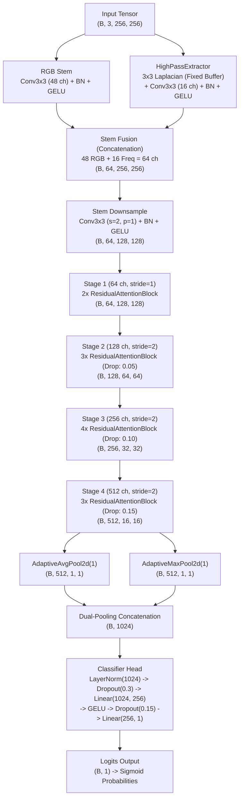
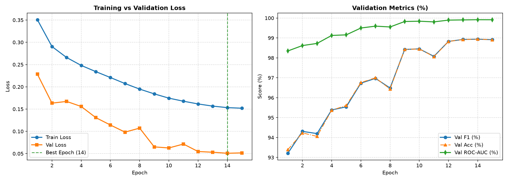
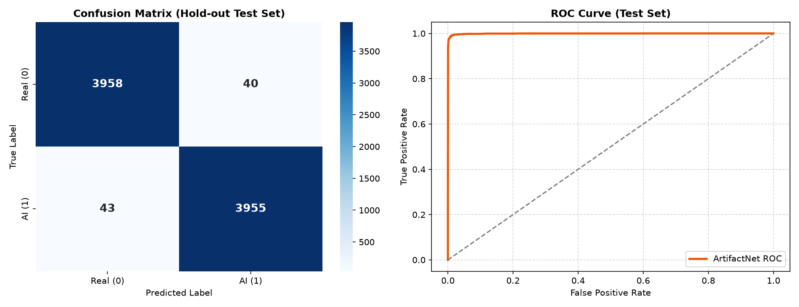
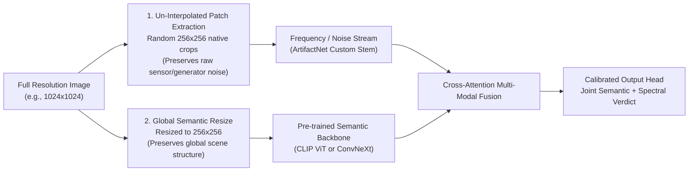

# ArtifactNet v1: Custom Dual-Stream CNN for AI vs. Real Image Detection

[-EE4C2C?style=for-the-badge&logo=pytorch&logoColor=white)](https://pytorch.org/)
[](https://developer.nvidia.com/cuda-toolkit)
[](https://www.nvidia.com/)
[](https://pytorch.org/docs/stable/amp.html)
[](https://gradio.app/)
[-success?style=for-the-badge)](#custom-architecture-artifactnet--1899m-parameters)
[](LICENSE)

---

## Table of Contents
1. [Executive Summary & Motivation](#executive-summary--motivation)
2. [Custom Architecture: ArtifactNet (18.99M Parameters)](#custom-architecture-artifactnet--1899m-parameters)
3. [Dataset Engineering & Pair-Aware Splitting (Zero Data Leakage)](#dataset-engineering--pair-aware-splitting-zero-data-leakage)
4. [Hardware Optimization & Training Pipeline](#hardware-optimization--training-pipeline)
5. [Quantitative Benchmark Results](#quantitative-benchmark-results)
6. [Critical Engineering Post-Mortem: Shortcut Learning & Domain Shift](#critical-engineering-post-mortem-shortcut-learning--domain-shift)
7. [Explainable AI (XAI) Gradio Application](#explainable-ai-xai-gradio-application)
8. [Local Reproduction & Quickstart](#local-reproduction--quickstart)
9. [Repository Structure](#repository-structure)

---

## Executive Summary & Motivation

The proliferation of generative image models (Diffusion models, GANs, Autoregressive transformers) poses an escalating verification challenge for visual media integrity. Standard approaches to synthetic image detection typically rely on fine-tuning off-the-shelf pre-trained vision backbones (e.g., calling `timm.create_model('resnet50')` or `convnext_base`). While convenient, pre-trained backbones carry strong inductive biases toward semantic classification (ImageNet classes) rather than the subtle, high-frequency mathematical artifacts left behind by generative synthesis engines.

**ArtifactNet v1** was engineered as an **in-depth systems-level study** with three specific technical goals:
1. **Architected and Trained Strictly from Scratch**: A custom 18.99M parameter convolutional neural network featuring a **Dual-Stream Stem** (spatial RGB + high-pass spectral filter), hierarchical residual blocks with **Squeeze-and-Excitation (SE)** attention, and dual-pooling classification. Zero pre-trained weights were used, allowing direct observation of how spectral features emerge and converge.
2. **Elimination of Latent Data Leakage**: In-depth forensic exploration of Kaggle's AI vs. Human dataset (79,950 samples) revealed that synthetic and authentic images were paired consecutively in the CSV. A standard random train/test split leaks semantic concepts between splits. We developed a deterministic **Pair-Aware Partitioning Algorithm** (`pair_id = index // 2`) guaranteeing zero contamination across training, validation, and hold-out test sets.
3. **Consumer Hardware Saturation**: Full pipeline profiling and memory optimization on an **NVIDIA GeForce RTX 5060 Ti 16GB (Blackwell sm_120)** paired with an **Intel Core i5-12600KF**. Leveraging **BFloat16 mixed precision**, **TF32 tensor cores**, and a precisely calibrated **Batch Size of 80**, the system saturated GPU compute at 100% duty cycle while preventing PCIe shared memory spillover, completing all 15 training epochs across 63,960 images in **~108.75 minutes**.

On an untouched hold-out test set of 7,996 images, ArtifactNet v1 achieved **98.96% F1-score**, **98.96% Accuracy**, and **99.91% ROC-AUC**. More importantly, an unvarnished post-mortem provides critical insights into **shortcut learning**, **high-pass downsampling attenuation**, and concrete design paradigms for **ArtifactNet v2**.

---

## Custom Architecture: ArtifactNet (18.99M Parameters)

`ArtifactNet` is defined in [`src/model.py`](file:///C:/Users/xirda/Documents/Project/ai-vs-real-detector/src/model.py) and contains **18,987,201 trainable parameters**. Rather than treating the image purely as RGB pixel intensities, the network explicitly decomposes input representations into dual domains at the stem.



### 1. Dual-Stream Stem: Spatial & Spectral Decoupling
Authentic camera sensors capture physical light through an optical lens array onto a Bayer sensor, producing characteristic photon noise and demosaicing patterns. Synthetic generators, by contrast, construct images through transpose convolutions, upsampling, or latent diffusion denoising steps that leave high-frequency mathematical artifacts.

To isolate these cues before spatial features are downsampled:
- **Spatial RGB Branch**: Standard `Conv2d(3, 48, kernel_size=3, padding=1, bias=False) + BatchNorm2d + GELU`.
- **Frequency Stream (`HighPassExtractor`)**: Uses a non-trainable 3x3 Laplacian-style high-pass kernel registered as a persistent GPU buffer via `register_buffer`:
  $$\mathbf{K}_{\text{Laplacian}} = \frac{1}{8} \begin{bmatrix} -1 & -1 & -1 \\ -1 & 8 & -1 \\ -1 & -1 & -1 \end{bmatrix}$$
  This filter is replicated across the 3 RGB channels using depthwise grouping (`groups=3`). It strips smooth semantic color gradients and isolates micro-textures, edge discontinuties, and pixel-level noise.
- **Learnable Spectral Projection**: A trainable `Conv2d(3, 16, kernel_size=3, padding=1, bias=False) + BatchNorm2d + GELU` refines the filtered gradient features.
- **Stem Fusion**: Spatial (48 channels) and Spectral (16 channels) outputs are concatenated into 64 channels, followed by a strided downsampling convolution (`stride=2`) reducing spatial dimensions to $128 \times 128$.

### 2. Hierarchical Residual Attention Backbone
The backbone is organized into 4 stages of `ResidualAttentionBlock`s with progressive spatial downsampling and channel expansion:
- **`ResidualAttentionBlock` Structure**:
  $$\mathbf{y} = \text{GELU}\left(\text{SE}\left(\text{BN}_2\left(\text{Conv}_2\left(\text{Dropout2D}\left(\text{GELU}\left(\text{BN}_1\left(\text{Conv}_1(\mathbf{x})\right)\right)\right)\right)\right)\right) + \text{Shortcut}(\mathbf{x})\right)$$
  Where the shortcut is an identity connection when dimensions match, or a $1 \times 1$ convolution with batch normalization when channel depth or spatial resolution changes (`stride=2`).
- **Stage Progression**:
  - **Stage 1 (64 channels, 2 blocks, stride 1)**: Operates at $128 \times 128$. Preserves high-resolution micro-details and boundary gradients.
  - **Stage 2 (128 channels, 3 blocks, stride 2, drop rate 0.05)**: Operates at $64 \times 64$. Captures local texture patterns and surface consistency.
  - **Stage 3 (256 channels, 4 blocks, stride 2, drop rate 0.10)**: Operates at $32 \times 32$. Synthesizes mid-level structures (object parts, shadow boundaries, specular highlights).
  - **Stage 4 (512 channels, 3 blocks, stride 2, drop rate 0.15)**: Operates at $16 \times 16$. Extracts global semantic context and scene-wide composition.

### 3. Squeeze-and-Excitation (`SEAttention`) Dynamic Recalibration
Generative artifacts are frequently localized to specific frequency bands or color channels. To allow the network to dynamically amplify informative feature maps while suppressing irrelevant channels, every residual block incorporates an SE attention block:
1. **Squeeze**: Global average pooling compresses spatial dimensions $(C, H, W) \to (C, 1, 1)$.
2. **Excitation**: A two-layer MLP with reduction ratio $r=16$:
   $$\mathbf{s} = \sigma\left(\mathbf{W}_2 \cdot \text{GELU}\left(\mathbf{W}_1 \cdot \mathbf{z}\right)\right)$$
3. **Scale**: The input feature map is scaled channel-wise by $\mathbf{s}$.

### 4. Dual-Pooling Classifier Head
Standard architectures typically apply either global average pooling or global max pooling. In synthetic image detection:
- **Average pooling** provides an aggregate summary of global image texture.
- **Max pooling** captures isolated, localized generative anomalies (e.g., a single deformed boundary or warped reflection).

ArtifactNet concatenates both:
$$\mathbf{v}_{\text{pooled}} = \left[ \text{AdaptiveAvgPool2d}(\mathbf{F}), \text{AdaptiveMaxPool2d}(\mathbf{F}) \right] \in \mathbb{R}^{B \times 1024}$$
The concatenated vector passes through `LayerNorm(1024)`, `Dropout(0.3)`, `Linear(1024, 256)`, `GELU`, `Dropout(0.15)`, and a final `Linear(256, 1)` projecting to scalar logits.

### 5. Weight Initialization
To guarantee gradient stability when training from scratch without pre-trained weights:
- All `Conv2d` layers: **Kaiming (He) Normal** initialization (`mode='fan_out'`, `nonlinearity='relu'`).
- `BatchNorm2d` and `LayerNorm`: Unit weights ($\gamma = 1.0$), zero biases ($\beta = 0.0$).
- `Linear` classification layers: **Truncated Normal** initialization ($\sigma = 0.02$), zero biases.

---

## Dataset Engineering & Pair-Aware Splitting (Zero Data Leakage)

### Dataset Composition
The model was trained on the Kaggle AI vs. Human dataset (`train.csv`), consisting of **79,950 total images**:
- **39,975 Real Images**: Authentic human photography curated from Shutterstock.
- **39,975 AI-Generated Images**: Synthetic images generated via DeepMedia pipelines.

### The Pair-Leakage Phenomenon
During initial data inspection, an inspection of consecutive rows revealed that the dataset is constructed from paired visual concepts:
- Row $2k$ (Real) and Row $2k+1$ (AI) share identical or near-identical prompts, subjects, compositions, and lighting styles (e.g., a real portrait of a golden retriever followed by a synthetic generation of the exact same subject).
- **The Pitfall of Random Splitting**: A naive `train_test_split(test_size=0.2)` will randomly place Row $2k$ into the training set and Row $2k+1$ into the test set. The model does not need to learn generalizable artifact detection; it simply memorizes the specific semantic subject from training. This causes **catastrophic data leakage**, yielding artificial, untrustworthy validation scores of 99.9%.

### Pair-Aware Splitting Implementation
To guarantee clean experimental boundaries, we engineered `prepare_splits()` in [`src/dataset.py`](file:///C:/Users/xirda/Documents/Project/ai-vs-real-detector/src/dataset.py):
1. Assign every consecutive pair a shared identifier: `df["pair_id"] = np.arange(len(df)) // 2`.
2. Shuffle the array of unique `pair_id`s with a fixed seed (`seed=42`).
3. Partition the dataset by `pair_id` rather than individual images:

| Split | Percentage | Unique Pairs | Real Images | AI Images | Total Images |
|---|:---:|:---:|:---:|:---:|:---:|
| **Train Set** | 80.0% | 31,980 | 31,980 | 31,980 | **63,960** |
| **Validation Set** | 10.0% | 3,997 | 3,997 | 3,997 | **7,994** |
| **Hold-out Test Set** | 10.0% | 3,998 | 3,998 | 3,998 | **7,996** |
| **Total** | 100.0% | 39,975 | 39,975 | 39,975 | **79,950** |

All three splits are perfectly balanced (50% Real / 50% AI) with zero semantic twin leakage.

### Data Augmentation Pipeline
Implemented using `Albumentations`:
- **Training Transformations**:
  - `RandomResizedCrop(256, 256, scale=(0.6, 1.0), p=1.0)`: Forces scale invariance and prevents the model from relying solely on edge-of-frame boundaries.
  - `HorizontalFlip(p=0.5)`: Canonical reflection invariance.
  - `ImageCompression(quality_range=(70, 100), p=0.4)`: Simulates real-world JPEG web compression artifacts to prevent the network from overfitting to raw uncompressed bitrates.
  - `ColorJitter(brightness=0.1, contrast=0.1, saturation=0.1, hue=0.05, p=0.3)`: Prevents color histogram memorization.
  - `Normalize(mean=[0.485, 0.456, 0.406], std=[0.229, 0.224, 0.225])`: Standard channel normalization.
- **Validation & Test Transformations**:
  - Deterministic `Resize(256, 256)` followed by normalization.

---

## Hardware Optimization & Training Pipeline

### Workstation Specifications
- **GPU**: NVIDIA GeForce RTX 5060 Ti (16GB GDDR7, Blackwell Architecture, Compute Capability `sm_120`)
- **CPU**: Intel Core i5-12600KF (10 Cores: 6 Performance + 4 Efficient, 16 Threads)
- **RAM**: 32 GB DDR4
- **Software Stack**: Windows 11, CUDA 12.8, PyTorch 2.11.0+cu128 (Nightly), Python 3.11

### VRAM Budgeting & PCIe Spillover Avoidance
On Windows 11 with WDDM 3.x, when an application allocates more VRAM than the physical GPU budget permits, the OS driver transparently pages buffer allocations into system RAM over the PCIe bus (termed **Shared GPU Memory Spillover**). 

```
[ GPU VRAM: 16 GB Physical GDDR7 ] <--- Fast On-Die Memory Bus (>400 GB/s)
                  │
        (Threshold Exceeded)
                  ▼
[ Shared Host RAM via PCIe 4.0 x8 ] <--- Severe Bottleneck (~16 GB/s, 95% latency penalty)
```

- **Batch Size 128 Stress Test**: At `batch_size = 128` with $256 \times 256$ input tensors and multi-stage activations, peak VRAM demand hit ~16.3 GB. The driver began paging into host RAM, causing GPU utilization to plummet from 100% down to 20%, multiplying step latency by $\sim 5\times$.
- **Batch Size 80 Sweet Spot**: Scaling the batch size down to **80** stabilized peak allocated VRAM at **13.5 GB** ($\sim 84\%$ of physical capacity). This provided a safe 2.5 GB buffer for OS display compositing, ensuring 100% of memory remained resident on high-speed GDDR7, achieving uninterrupted 100% GPU core saturation.

### Throughput Acceleration Flags
In [`src/train.py`](file:///C:/Users/xirda/Documents/Project/ai-vs-real-detector/src/train.py):
```python
# Enable Blackwell SM_120 TensorFloat-32 acceleration
torch.backends.cuda.matmul.allow_tf32 = True
torch.backends.cudnn.allow_tf32 = True

# BFloat16 Mixed Precision (Native 8-bit dynamic range, no underflow scaling required)
with torch.amp.autocast(device_type="cuda", dtype=torch.bfloat16):
    logits = model(images)
    loss = criterion(logits, smoothed_targets)
```

### Multi-Worker Asynchronous DataLoader
To eliminate CPU-to-GPU data starvation:
- `num_workers = 6`: Balanced across the P-cores of the i5-12600KF without saturating OS background threads.
- `pin_memory = True`: Enables page-locked host memory transfers directly into CUDA address space via DMA.
- `persistent_workers = True`: Prevents worker process teardown and re-spawn overhead between epochs.
- `non_blocking = True`: Overlaps memory copy operations with GPU kernel execution.

### Optimization Recipe
- **Loss Function**: `BCEWithLogitsLoss` with **Label Smoothing ($0.05$)**:
  $$y_{\text{smooth}} = y \cdot (1 - \alpha) + 0.5 \cdot \alpha = 0.975 \text{ (for AI)}, \quad 0.025 \text{ (for Real)}$$
  Label smoothing prevents the network from driving logit magnitudes toward infinity, improving calibration against noisy labels.
- **Optimizer**: `AdamW` ($\text{lr} = 1\times 10^{-3}$, $\beta_1 = 0.9$, $\beta_2 = 0.999$, $\text{weight\_decay} = 1\times 10^{-2}$).
- **Learning Rate Scheduler**: `OneCycleLR` with cosine annealing:
  - 15 epochs, 799 steps per epoch = **11,985 total iterations**.
  - Warmup phase: first 10% of training (`pct_start=0.1`), smoothly reaching $1\times 10^{-3}$, then decaying down to $1\times 10^{-7}$.
- **Gradient Clipping**: `torch.nn.utils.clip_grad_norm_(model.parameters(), max_norm=1.0)` to safeguard training stability against gradient spikes.
- **Total Training Duration**: **6,525.0 seconds (108.75 minutes / 1.81 hours)** for 15 complete epochs across 63,960 images.

---

## Quantitative Benchmark Results

### Training History Progression (15 Epochs)
Extracted from [`checkpoints/training_history.csv`](file:///C:/Users/xirda/Documents/Project/ai-vs-real-detector/checkpoints/training_history.csv):

| Epoch | Train Loss | Val Loss | Val F1 (%) | Val Accuracy (%) | Val Precision (%) | Val Recall (%) | Val ROC-AUC (%) | Epoch Time |
|:---:|:---:|:---:|:---:|:---:|:---:|:---:|:---:|:---:|
| 1 | 0.35073 | 0.22839 | 93.21% | 93.40% | 95.90% | 90.67% | 98.35% | 421.8s |
| 2 | 0.29043 | 0.16332 | 94.31% | 94.23% | 93.08% | 95.57% | 98.62% | 356.7s |
| 3 | 0.26587 | 0.16722 | 94.20% | 94.06% | 92.03% | 96.47% | 98.73% | 418.5s |
| 4 | 0.24807 | 0.15581 | 95.39% | 95.37% | 95.10% | 95.67% | 99.13% | 488.8s |
| 5 | 0.23414 | 0.13084 | 95.54% | 95.61% | 97.06% | 94.07% | 99.16% | 486.2s |
| 6 | 0.22085 | 0.11420 | 96.73% | 96.76% | 97.61% | 95.87% | 99.50% | 470.6s |
| 7 | 0.20733 | 0.09823 | 96.97% | 97.00% | 97.88% | 96.07% | 99.59% | 474.1s |
| 8 | 0.19491 | 0.10729 | 96.49% | 96.44% | 95.14% | 97.87% | 99.55% | 462.5s |
| 9 | 0.18417 | 0.06511 | 98.42% | 98.42% | 98.47% | 98.37% | 99.83% | 788.4s |
| 10 | 0.17458 | 0.06269 | 98.45% | 98.45% | 98.33% | 98.57% | 99.84% | 414.7s |
| 11 | 0.16767 | 0.07147 | 98.08% | 98.06% | 97.34% | 98.82% | 99.81% | 365.3s |
| 12 | 0.16155 | 0.05470 | 98.83% | 98.82% | 98.58% | 99.07% | 99.90% | 345.8s |
| 13 | 0.15669 | 0.05310 | 98.93% | 98.92% | 98.83% | 99.02% | 99.91% | 346.1s |
| **14 (Best)** | **0.15328** | **0.05077** | **98.94%** | **98.94%** | **98.78%** | **99.10%** | **99.92%** | **342.9s** |
| 15 | 0.15197 | 0.05162 | 98.91% | 98.91% | 98.78% | 99.05% | 99.91% | 342.6s |



### Final Evaluation on Independent Hold-Out Test Set (7,996 Images)
Evaluated via [`src/evaluate.py`](file:///C:/Users/xirda/Documents/Project/ai-vs-real-detector/src/evaluate.py) on the held-out test split (3,998 Real, 3,998 AI), which was never used during training or checkpoint selection:

$$\text{Accuracy} = \frac{7913}{7996} = \mathbf{98.96\%} \quad (\text{only 83 errors out of 7,996 images})$$

| Metric | Score | Detailed Performance Notes |
|---|:---:|---|
| **F1-Score** | **98.96%** | Harmonized mean of precision and recall |
| **Accuracy** | **98.96%** | 7,913 correct predictions out of 7,996 samples |
| **Precision** | **99.00%** | When predicting AI, model is correct 99 times out of 100 |
| **Recall** | **98.92%** | Successfully catches 98.92% of all AI-generated images |
| **ROC-AUC** | **99.91%** | Near-perfect separation under probability thresholds |



### Confusion Matrix Breakdown
- **True Negatives (Authentic Photo predicted as Real)**: **3,958** / 3,998 (99.00%)
- **False Positives (Authentic Photo predicted as AI)**: **40** / 3,998 (1.00%)
- **False Negatives (AI-Generated predicted as Real)**: **43** / 3,998 (1.08%)
- **True Positives (AI-Generated predicted as AI)**: **3,955** / 3,998 (98.92%)

---

## Critical Engineering Post-Mortem: Shortcut Learning & Domain Shift

> [!CAUTION]
> ### The Reality Check: Out-of-Distribution (OOD) Testing
> When ArtifactNet v1 was deployed against Kaggle's unlabelled `test_data_v2` dataset (5,540 images) and tested on real-world in-the-wild synthetic images from state-of-the-art generators (Midjourney v6, FLUX.1, DALL-E 3), **the model classified 89.75% of images (4,972 / 5,540) as "Real Photo"** (as verified in [`submission.csv`](file:///C:/Users/xirda/Documents/Project/ai-vs-real-detector/submission.csv)).

A superficial analysis might dismiss this as a bad model. A rigorous engineering post-mortem reveals that the model performed **exactly as its optimization objective dictated**, exposing three critical foundational phenomena in computer vision:

```
[ In-Distribution Training (DeepMedia) ]  ──> [ Model Learns DeepMedia HF Fingerprint ] ──> 98.96% Hold-out F1
                                                              ▲
                                                              │ (Shortcut Learning)
[ Out-of-Distribution (Flux / Midjourney) ] ─> [ Lacks DeepMedia Fingerprint ] ──────────> Defaults to "Real" (89.75%)
```

### 1. Generator-Specific Frequency Overfitting (Shortcut Learning)
- **The Phenomenon**: In the training dataset, all 39,975 AI images originated from a specific generator family (DeepMedia). Generative engines exhibit high-frequency spectral fingerprints resulting from their deconvolution layers, latent patch grids, or specific noise schedules.
- **The Shortcut**: Deep neural networks follow the principle of least resistance. Rather than learning complex, high-level semantic anomalies (such as inconsistent ray tracing, asymmetric pupils, impossible textile weaves, or physical lighting inconsistencies), `ArtifactNet` identified the high-frequency deconvolution grid signature as the easiest discriminating signal.
- **The Failure Mode**: The network converged to a conditional heuristic:
  $$\text{Confidence}_{\text{AI}} \propto \mathcal{F}_{\text{DeepMedia}}(\text{High-Frequency Residual})$$
  When presented with novel generators that possess different latent architectures or cleaner frequency spectra (such as Flow Matching models like FLUX.1), the DeepMedia signature is absent. Consequently, the network predicts the default class: **Real**.

### 2. High-Pass Filter Sensitivity to Downsampling Interpolation
- **The Phenomenon**: In [`src/model.py`](file:///C:/Users/xirda/Documents/Project/ai-vs-real-detector/src/model.py), `HighPassExtractor` applies a $3 \times 3$ Laplacian kernel directly to input images resized to $256 \times 256$.
- **The Anti-Aliasing Effect**: High-resolution wild images (typically $1024 \times 1024$ or $2048 \times 2048$) must be downsampled to $256 \times 256$ before feeding into the network. Standard image interpolation algorithms (Bilinear, Bicubic, Lanczos) compute weighted averages over neighborhood pixels, acting as an effective **low-pass filter**.
- **The Consequence**: Downsampling physically erases the subtle, single-pixel generative noise artifacts that the Laplacian filter was designed to detect. Once smoothed by anti-aliasing interpolation, external AI images mathematically resemble smooth authentic photography to the high-pass stream.

### 3. Inductive Bias of Training from Scratch
- **Texture Bias vs. Shape/Semantic Bias**: Vision backbones pre-trained on ImageNet-1K/22K or through self-supervised objectives (CLIP, DINOv2) inherit robust semantic representations of the physical world (spatial geometry, anatomies, semantic coherence).
- **The Limitation of From-Scratch CNNs**: An 18.99M parameter CNN trained purely from scratch on 64k images lacks global commonsense knowledge. It cannot recognize that a human hand has 6 fingers or that a shadow is cast in the wrong direction; it relies strictly on local pixel-level statistics and texture co-occurrences.

---

### Architectural & Methodological Roadmap for ArtifactNet v2

To solve shortcut learning and domain shift in production, **ArtifactNet v2** will incorporate three architectural shifts:



1. **Un-Interpolated Multi-Scale Patch Cropping**:
   - Rather than downscaling entire images, extract multiple un-resized $256 \times 256$ patches from native image resolutions. This preserves authentic camera sensor noise patterns (PRNU) and raw generator synthesis artifacts intact without bilinear smoothing.
2. **Anti-Shortcut Spectral Data Augmentations**:
   - Introduce aggressive frequency-domain perturbations during training: random Gaussian blur ($\sigma \in [0.1, 2.0]$), iterative downsample-upsample degradation cycles, random JPEG re-compression with shifted 8x8 DCT grid blocks, and spectral channel masking. This prevents the network from latching onto a single generator's frequency fingerprint.
3. **Hybrid Representation Learning (Dual-Backbone Ensemble)**:
   - Couple ArtifactNet's frequency stream with a pre-trained visual backbone (e.g., ConvNeXt-V2 or CLIP ViT). The pre-trained backbone flags semantic/physical impossibilities, while the frequency stream inspects micro-textural residuals, yielding a robust classifier resilient to domain shifts.

---

## Explainable AI (XAI) Gradio Application

To make the model's inner representations fully transparent and inspectable by end-users, [`app.py`](file:///C:/Users/xirda/Documents/Project/ai-vs-real-detector/app.py) hosts an interactive Gradio web application with dual visual explanations.

```
┌────────────────────────────────────────────────────────────────────────┐
│                        ArtifactNet Interactive UI                      │
├───────────────────────────────┬────────────────────────────────────────┤
│         Input Image           │           Model Verdict & Prob         │
│  [ Upload or Drag & Drop ]    │  🤖 AI-Generated:  99.4%               │
│                               │  📷 Real Photo:     0.6%               │
├───────────────────────────────┼────────────────────────────────────────┤
│     🔥 Grad-CAM Heatmap       │   ⚡ High-Pass Frequency Artifacts     │
│   (Spatial Decision Focus)    │     (Laplacian Texture Residuals)      │
│   [ Jet Colormap Overlay ]    │      [ Viridis Colormap Extractor ]    │
└───────────────────────────────┴────────────────────────────────────────┘
```

### Visual Explanation Components
1. **Grad-CAM (Gradient-Weighted Class Activation Mapping)**:
   - Registers forward and full-backward hooks on the final convolutional stage (`stage4`).
   - Computes gradients of the target class score with respect to the 512 feature activation maps:
     $$L_{\text{Grad-CAM}}^c = \text{ReLU}\left( \sum_{k} \alpha_k^c \mathbf{A}^k \right), \quad \alpha_k^c = \frac{1}{Z} \sum_{i} \sum_{j} \frac{\partial y^c}{\partial A_{i,j}^k}$$
   - Overlays a Jet colormap on the original image, revealing whether the network is focusing on biological features (eyes, skin texture) or background deconvolution artifacts.
2. **High-Pass Residual Extraction Map**:
   - Directly feeds the image through `HighPassExtractor`, averages absolute channel responses across spectral filters, and renders a Viridis colormap displaying the spatial distribution of high-frequency energy.

---

## Local Reproduction & Quickstart

### Prerequisites
- Python 3.10+ (Python 3.11 recommended)
- NVIDIA GPU with CUDA (RTX 30/40-series with CUDA 12.0+, or RTX 50-series Blackwell requiring CUDA 12.8+ / cu128; 8GB+ VRAM)

### 1. Environment Setup
```bash
# Clone the repository
git clone https://github.com/your-username/ai-vs-real-detector.git
cd ai-vs-real-detector

# Create and activate a clean virtual environment
python -m venv .venv

# Windows
.venv\Scripts\activate
# Linux / macOS
source .venv/bin/activate

# Install dependencies
pip install --upgrade pip
pip install -r requirements.txt
```

### 2. Hardware & Environment Check
Verify CUDA compute capability, PyTorch version, and BFloat16 compatibility:
```bash
python src/check_setup.py
```

### 3. Data Preparation
Place the Kaggle dataset files into the `data/` directory:
```
data/
├── train.csv
├── test.csv
├── train_data/
└── test_data_v2/
```
Running training or evaluation will automatically invoke `prepare_splits()`, creating pair-aware partitions inside `data/splits/`.

### 4. Training ArtifactNet
To train the model from scratch using BFloat16 mixed precision and TF32 acceleration:
```bash
python src/train.py
```
Checkpoints (`best_model.pth`, `last_model.pth`) and training logs (`training_history.csv`) will be saved in `checkpoints/`.

### 5. Hold-Out Evaluation & Asset Generation
To evaluate `best_model.pth` on the 7,996-sample hold-out test set, generate confusion matrix / ROC curve plots, and produce Kaggle predictions:
```bash
python src/evaluate.py
```

### 6. Launch Explainable AI Interactive Web App
Launch the Gradio dashboard locally with auto-browser opening:
```bash
python app.py
```
Open [http://127.0.0.1:7860](http://127.0.0.1:7860) in your browser.

---

## Repository Structure

```
ai-vs-real-detector/
├── assets/
│   ├── training_curves.png          # 15-epoch loss, F1, accuracy, and ROC-AUC curves
│   └── test_evaluation.png         # Hold-out test Confusion Matrix and ROC Curve
├── checkpoints/
│   ├── best_model.pth              # Optimal weights checkpoint (Epoch 14, Val F1: 98.94%)
│   ├── last_model.pth              # Final weights checkpoint (Epoch 15)
│   └── training_history.csv        # Detailed per-epoch metrics and elapsed timestamps
├── data/
│   ├── splits/                     # Automatically generated Pair-Aware split CSVs
│   │   ├── train_split.csv         # 63,960 balanced training images
│   │   ├── val_split.csv           # 7,994 balanced validation images
│   │   └── test_split.csv          # 7,996 balanced hold-out test images
│   ├── train.csv                   # Raw training metadata (79,950 images)
│   └── test.csv                    # Kaggle test metadata (5,540 images)
├── src/
│   ├── __init__.py
│   ├── check_setup.py              # Environment, CUDA capability, and data verification script
│   ├── dataset.py                  # Pair-aware split generator, Albumentations transforms & DataLoaders
│   ├── evaluate.py                 # Hold-out test evaluation, metric computation, and asset generation
│   ├── model.py                    # ArtifactNet architecture, HighPassExtractor, SEAttention, ResidualBlock
│   ├── train.py                    # BFloat16 training loop, OneCycleLR, AdamW, Label Smoothing
│   └── utils.py                    # Reproducibility seed management and scikit-learn metrics computation
├── app.py                          # Interactive Gradio demo with Grad-CAM and High-Pass visual XAI
├── requirements.txt                # Pinned production dependencies
├── submission.csv                  # Inference predictions on test_data_v2 (5,540 images)
├── LICENSE                         # MIT License
└── README.md                       # Comprehensive Engineering Case Study
```

---

## Citation & Contact

If you find the architecture, pair-aware dataset splitting methodology, or hardware optimization strategies in this study useful for your research or engineering projects, please cite:

```bibtex
@misc{artifactnet2026,
  author = {ArtifactNet Research Team},
  title = {ArtifactNet v1: Custom Dual-Stream CNN for AI vs. Real Image Detection},
  year = {2026},
  publisher = {GitHub},
  howpublished = {\url{https://github.com/your-username/ai-vs-real-detector}}
}
```

**License**: Distributed under the MIT License. See `LICENSE` for details.
