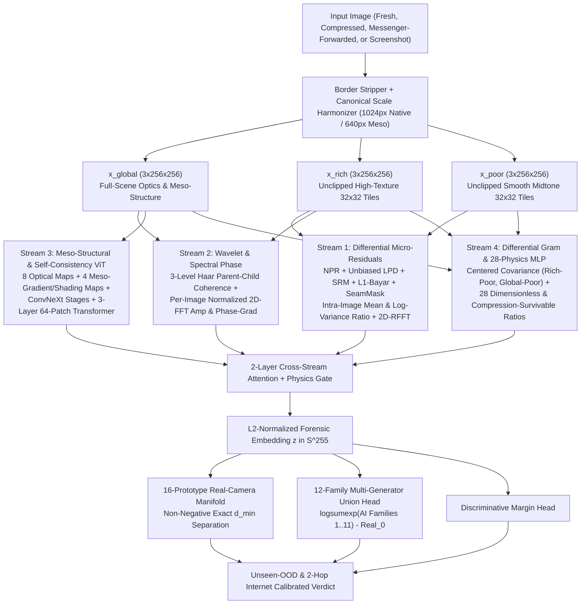

# ArtifactNet v5: From-Scratch Multi-Generator & Internet-Resilient AI Image Detector

[-EE4C2C?style=for-the-badge&logo=pytorch&logoColor=white)](https://pytorch.org/)
[](https://developer.nvidia.com/cuda-toolkit)
[](https://www.nvidia.com/)
[](https://pytorch.org/docs/stable/amp.html)
[](https://gradio.app/)
[](#architecture-artifactnet-v5)
[](LICENSE)

---

## Executive Summary

**ArtifactNet v5** (`16.74M` trainable parameters) is a digital image forensics system designed and trained **100% from scratch** (**zero pretrained backbones, zero external model weights**) to distinguish AI-generated images from authentic camera photographs—both on **fresh generator outputs** and on **real-world internet-circulated images** (compressed, uploaded, downloaded, forwarded via WhatsApp/Instagram/Reddit/Telegram, or screenshotted).

### Why Earlier Single-Generator Detectors Failed in the Wild
1. **Single-Generator Hyperplane Trap ("100% Real" Collapse)**: Training binary cross-entropy against a single older AI generator teaches *"Generator A vs. Everything Else = Real"*. Modern frontier engines (`GPT-Image`, `FLUX.1/2`, `Midjourney v6/v7`, `Nano-Banana / Imagen 4`, `Seedream`, `Ideogram`, `Recraft`, `Qwen-Image`) do not exhibit that single generator's exact high-frequency spike and collapse to `Real`.
2. **Internet Laundering Destruction of Fragile Micro-Artifacts**: Real-world AI images shared online undergo multi-hop resizing, chroma `4:2:0` subsampling, platform unsharp masking, `JPEG` / `WebP` re-quantization, and browser/screenshot saves. Detectors relying solely on raw pixel noise lose recall as soon as an image is sent over a messenger or downloaded from social media.

### How ArtifactNet v5 Solves Both Challenges From Scratch
1. **Zero-Cache Multi-Generator & Real-Camera Harvester ([`src/harvest_dataset.py`](src/harvest_dataset.py))**: Streams and verifies diverse 2024–2026 synthetic families (`OpenFake`, `Defactify`, `CommunityForensics-Eval`, in-the-wild `Reddit` & `Civitai` uploads) alongside multi-camera authentic photography (`Pexels`, `MS-COCO`, `VISION` / `Forchheim` / `IMD2020` / `FFHQ` smartphones & DSLRs) with strict `C:\` disk-budget guards and zero Hugging Face cache bloat.
2. **Pair-Synchronized 1-Hop & 2-Hop Internet Laundering Pipeline ([`src/dataset.py`](src/dataset.py))**: Applies identical WhatsApp/Instagram/Telegram/WebP compression, `Uploaded -> Compressed -> Downloaded -> Forwarded` 2-hop chains, and compressed-to-PNG screenshot saves to matched `(Real_k, AI_k)` pairs—forcing the network to learn **compression-survivable physical & meso-structural invariants** with zero codec shortcuts.
3. **12-Class Generator-Family Union Head + Non-Negative 16-Prototype Real-Camera Manifold ([`src/model.py`](src/model.py))**: Models 16 diverse authentic camera modes on $\mathbb{S}^{255}$ using exact `d_min` cosine separation while explicitly partitioning synthetic physics into 11 generator families (`family_ai_logit = logsumexp(AI_1..11) - Real_0`).
4. **28 Dimensionless & Meso-Scale Physical Ratios ([`src/forensics.py`](src/forensics.py))**: Adds `8×8` block boundary/interior step ratios, `2×`/`4×` meso-acutance decay, and radial lens center-to-corner sharpness falloff to `ScaleFreePhysicsExtractor`, calibrated jointly across unseen generators and 2-hop internet chains.

---

## Architecture: ArtifactNet v5

Defined in [`src/model.py`](src/model.py) and [`src/forensics.py`](src/forensics.py) (**100% From Scratch, Zero Pretrained Weights, Zero `BatchNorm`**):



---

## Quickstart & CLI Workflows

### 1. Environment & Dataset Check
```bash
.venv\Scripts\activate
python src/check_setup.py
```

### 2. Harvest Multi-Generator & Internet-Circulated Corpus (Zero HF Cache Bloat)
```bash
python src/harvest_dataset.py --max-gb 33.5 --min-free-gb 19.5
```
*Note: You can also drop any of your own personal photos into `data/custom/real/` and `data/custom/ai/` and run `python src/harvest_dataset.py --splits-only` to include them automatically.*

### 3. Train ArtifactNet v5 From Scratch
```bash
python src/train.py --epochs 14 --samples-per-epoch 84000
```
Useful flags:
- `--resume`: Seamlessly resume from `checkpoints/last_model_v5.pth`.
- `--calibrate-only`: Re-run 6-condition unseen-OOD + internet-laundering calibration on `checkpoints/best_model_v5.pth`.

### 4. Run Unseen-Generator & Internet-Laundering Stress Evaluation
Evaluates strictly unseen frontier generators (`GPT-Image 2.0`, `Midjourney v7`, `Nano-Banana Pro`, `Recraft v3`, `FLUX.2`, `Reddit` in-the-wild), prints per-generator accuracy, runs 6 internet-laundering & shortcut-knockout stress tests (`WhatsApp 1-Hop`, `2-Hop Upload->Download->Forward Chain`, `WebP CDN`, `Compressed->PNG Screenshot`, `Smartphone ISP`, `FFT Knock-Out`), saves `assets/test_evaluation_v5.png`, and generates `submission_v5.csv` / `submission.csv`:
```bash
python src/evaluate.py
```

### 5. Launch Interactive Gradio XAI Inspector
```bash
python app.py
```

---

## License
Distributed under the MIT License. See [`LICENSE`](LICENSE) for details.
